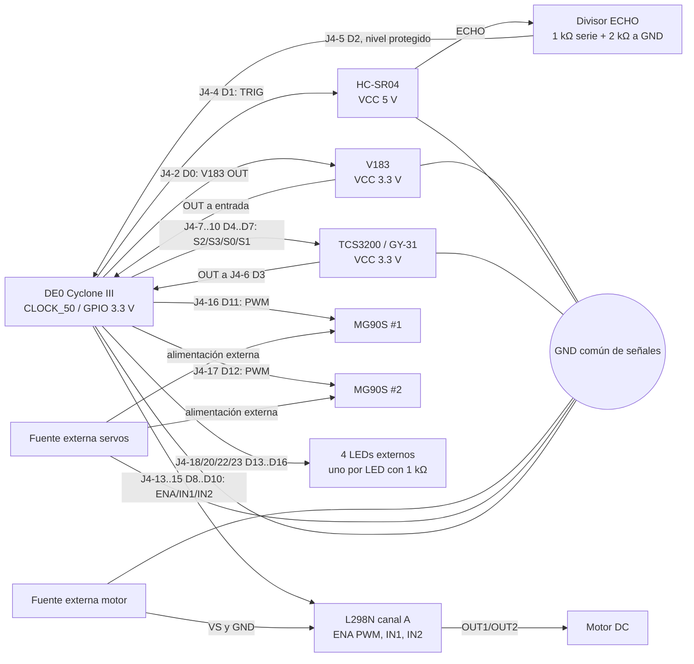

# Guía de cableado e integración física de System Alfa

Esta guía corresponde a la DE0 con Cyclone III EP3C16F484C6 y a los módulos confirmados en el proyecto. Distingue las pruebas que ya están separadas de la integración completa: el paquete de sensores incluye pruebas individuales, pero todavía no incluye `SystemAlfa_Hardware.vhd`, `SystemAlfa_Hardware.qsf` ni PWM/controladores para el motor o los servos.

## Estado de las pruebas

- **V183:** probado en la placa. La salida medida fue aproximadamente 3.34 V sin pieza y 0.1 V con pieza; la configuración usada es activa en bajo.
- **HC-SR04:** el usuario indica que la prueba individual funciona. `ECHO` debe continuar protegido con divisor resistivo antes de entrar a la FPGA.
- **TCS3200:** proyecto de prueba individual. La compensación actual sigue siendo preliminar y **todavía no caracteriza el verde como se espera**. No trasladar sus parámetros al sistema integrado hasta calibrar de nuevo con piezas reales.
- **Motor, L298N, servos y LEDs externos:** aún no están controlados por un TOP físico integrado. El mapa de abajo es una propuesta para la futura integración, no una asignación ya programada en un `.qsf`.

## Archivo principal

Para la prueba física completa, el TOP que se debe crear e integrar es `Hardware_Sensores/SystemAlfa_Hardware.vhd`. Será principalmente estructural: conectará V183, HC-SR04, TCS3200 y la lógica `SystemAlfa_Final`, y añadirá los controladores de motor y servos. Su entidad superior necesitará un `.qsf` con el mismo nombre de TOP y los pines del mapa propuesto.

Ese TOP **no está presente en la octava versión entregada**. No se puede seleccionar ni programar todavía como sistema completo. Los proyectos que sí puedes abrir hoy son:

| Prueba | Proyecto `.qpf` | TOP |
|---|---|---|
| Presencia | `Hardware_Sensores/Pruebas_Fisicas/V183/Prueba_V183.qpf` | `Prueba_V183` |
| Distancia | `Hardware_Sensores/Pruebas_Fisicas/HCSR04/Prueba_HCSR04.qpf` | `Prueba_HCSR04` |
| Color | `Hardware_Sensores/Pruebas_Fisicas/TCS3200/Prueba_TCS3200.qpf` | `Prueba_TCS3200` |

`SystemAlfa_Placa.vhd` es la interfaz para ensayar el núcleo con los botones y switches de la placa. `SystemAlfa_Sensores.vhd` acepta señales digitales de presencia/color/tamaño ya preparadas, pero **no** mide el HC-SR04 ni el TCS3200 y tampoco controla motores/servos. No reemplaza el futuro TOP físico.

## Mapa propuesto para J4 / GPIO 0

El manual DE0 muestra los contactos pares a la derecha y los impares a la izquierda mirando el conector como aparece en la placa. Verifica el pin 1 por la marca del conector antes de cablear. Los GPIO son de 3.3 V.

| J4 | GPIO0 | Pin FPGA | Señal propuesta | Dirección |
|---:|---|---|---|---|
| 2 | D0 | AB16 | V183 OUT | Entrada |
| 4 | D1 | AA16 | HC-SR04 TRIG | Salida |
| 5 | D2 | AA15 | Nodo protegido HC-SR04 ECHO | Entrada |
| 6 | D3 | AB15 | TCS3200 OUT | Entrada |
| 7 | D4 | AA14 | TCS3200 S2 | Salida |
| 8 | D5 | AB14 | TCS3200 S3 | Salida |
| 9 | D6 | AB13 | TCS3200 S0 | Salida |
| 10 | D7 | AA13 | TCS3200 S1 | Salida |
| 11 | +5 V | — | Riel de placa; solo para cargas pequeñas permitidas | Alimentación |
| 12 | GND | — | Tierra común | Tierra |
| 13 | D8 | AB10 | L298N ENA / PWM del motor | Salida |
| 14 | D9 | AA10 | L298N IN1 | Salida |
| 15 | D10 | AB8 | L298N IN2 | Salida |
| 16 | D11 | AA8 | Señal servo 1 | Salida |
| 17 | D12 | AB5 | Señal servo 2 | Salida |
| 18 | D13 | AA5 | LED externo categoría 3 | Salida |
| 20 | D14 | AB4 | LED externo categoría 4 | Salida |
| 22 | D15 | AA4 | LED externo categoría 5 | Salida |
| 23 | D16 | V14 | LED externo categoría 6 | Salida |
| 24 | D17 | U14 | Reserva para estado/LED adicional | Salida |
| 25 | D18 | Y13 | Reserva para estado/LED adicional | Salida |
| 29 | +3.3 V | — | Riel de 3.3 V para sensores compatibles | Alimentación |
| 30 | GND | — | Tierra común | Tierra |

No usar J4-1/J4-3 ni J4-19/J4-21 para estas señales: son contactos de reloj. Los números de contacto J4 y nombres `PIN_...` del FPGA son referencias distintas. Este mapa parte de la tabla/figura GPIO0 del [manual DE0](https://www.terasic.com.tw/attachment/archive/371/DE0_User_manual_v1.1.pdf) y de los `.qsf` de las pruebas de sensor; los pines D8 en adelante son asignaciones propuestas, aún por agregar al QSF del TOP físico.

## Cableado de cada módulo

### 1. V183

| Módulo V183 | Conectar a |
|---|---|
| VCC | J4-29, +3.3 V |
| GND | J4-12 o J4-30 |
| OUT | J4-2, GPIO0 D0 / PIN_AB16 |

La polaridad comprobada por el usuario es activa en bajo: OUT alto sin pieza y bajo al detectar pieza. No alimentar el módulo a 5 V mientras OUT esté conectado directamente a la FPGA.

### 2. HC-SR04

| HC-SR04 | Conectar a |
|---|---|
| VCC | Fuente de +5 V |
| GND | Tierra común (J4-12/30) |
| TRIG | J4-4, GPIO0 D1 / PIN_AA16 |
| ECHO | Divisor 1 kΩ / 2 kΩ descrito abajo; nodo a J4-5, GPIO0 D2 / PIN_AA15 |

```text
HC-SR04 ECHO ──[ 1 kΩ ]──┬── J4-5 / FPGA ECHO
                         │
                       [ 2 kΩ ]
                         │
GND común ────────────────┴── J4-12 o J4-30
```

El nodo queda cerca de 3.3 V cuando ECHO es 5 V. No conectes ECHO directamente a la DE0. Las lecturas de distancia y los umbrales de tamaño siguen siendo tarea de calibración con el sensor montado sobre la cinta.

### 3. TCS3200 / GY-31

| TCS3200 | Conectar a |
|---|---|
| VCC | J4-29, +3.3 V (si el módulo concreto funciona correctamente a esa tensión) |
| GND | J4-12 o J4-30 |
| OUT | J4-6 / D3 / PIN_AB15 |
| S2 | J4-7 / D4 / PIN_AA14 |
| S3 | J4-8 / D5 / PIN_AB14 |
| S0 | J4-9 / D6 / PIN_AB13 |
| S1 | J4-10 / D7 / PIN_AA13 |
| OE | GND, si el módulo expone este terminal |

La calibración del verde queda **pendiente**. El TCS debe tomar R, G y B con iluminación, distancia, orientación y superficie de fondo constantes. No considerar que el LED indique verde correctamente hasta contrastar muestras nuevas.

### 4. Motor DC y puente H L298N ZX-040

Se propone usar el canal A del módulo. Comprueba las etiquetas de tu placa L298N; algunos módulos nombran la alimentación del motor `+12V`, aunque se les conecte la fuente adecuada al motor usado.

| Módulo L298N | Conectar a |
|---|---|
| ENA | J4-13 / D8 / PIN_AB10; retirar el jumper ENA si cubre esta entrada PWM |
| IN1 | J4-14 / D9 / PIN_AA10 |
| IN2 | J4-15 / D10 / PIN_AB8 |
| OUT1 y OUT2 | Los dos terminales del motor DC |
| VS / alimentación motor | Fuente externa compatible con el motor; no GPIO ni salida de 3.3 V |
| GND del módulo | Negativo de la fuente de motor y GND común de la DE0 |
| VSS / 5V lógica del módulo | Según la serigrafía y jumper/regulador de TU placa L298N; verificar antes de energizar |

El PWM sale solo por ENA; IN1/IN2 controlan dirección/parada. Para una sola dirección fija, el control puede mantener una combinación estable y variar ENA. No conectes dos salidas de puente entre sí ni alimentes el motor desde la FPGA. Mide o consulta la corriente de arranque/bloqueo del motor antes de elegir fuente/driver; el L298 tiene caída de tensión y puede calentarse. La ficha de ST separa la alimentación de potencia VS de la alimentación lógica VSS y describe Enable/Inputs [L298 de ST](https://www.st.com/resource/en/datasheet/cd00000240.pdf).

### 5. Dos servomotores MG90S

| Servo | Conectar a |
|---|---|
| Servo 1 señal (amarillo/naranja, confirmar cable) | J4-16 / D11 / PIN_AA8 |
| Servo 2 señal | J4-17 / D12 / PIN_AB5 |
| Rojo de ambos | Fuente regulada externa para servos, tensión admitida por los servos concretos |
| Marrón/negro de ambos | Negativo de esa fuente y GND común con la DE0 |

No alimentes los servos desde un GPIO ni desde el pin 3.3 V. La DE0 solo entrega la señal de control; el PWM de servo y sus posiciones todavía deben implementarse y probarse. La asignación inicial sugerida es servo 1 para categoría 1 y servo 2 para categoría 2; cámbiala en la lógica de actuación cuando se defina el mecanismo. Usa una fuente dimensionada para la corriente simultánea de ambos servos. TowerPro indica alimentación externa y funcionamiento del MG90S a partir de 4.8 V [fabricante MG90S](https://towerpro.com.tw/product/mg90s-3/); verifica el rango de la unidad que tienes.

### 6. LEDs externos de categoría

Para representar las categorías 3 a 6, conecta cada salida propuesta con su propia resistencia en serie:

```text
J4-18 / D13 ──[ 1 kΩ ]── ánodo LED cat. 3; cátodo ── GND
J4-20 / D14 ──[ 1 kΩ ]── ánodo LED cat. 4; cátodo ── GND
J4-22 / D15 ──[ 1 kΩ ]── ánodo LED cat. 5; cátodo ── GND
J4-23 / D16 ──[ 1 kΩ ]── ánodo LED cat. 6; cátodo ── GND
```

No omitas la resistencia. Si los LEDs consumen más corriente o van lejos de la placa, usa un transistor/driver entre GPIO y LED. Los indicadores integrados `LEDG` siguen siendo salidas de diagnóstico, no conexiones de potencia para motor/servo.

### 7. Dos displays externos de ánodo común (opcional, posterior)

No conectarlos todavía al mapa principal. Requieren hasta 14 líneas de segmentos y circuitos de corriente adecuados. En ánodo común los segmentos se activan normalmente hundiendo corriente; coloca resistencia limitadora por segmento y transistores/driver para los comunes de dígito. No conectes el común del display directamente a una salida GPIO ni hagas circular la corriente de varios segmentos por un pin del FPGA. Si se implementan, se puede reservar GPIO1/J5, pero hay que definir primero el multiplexado, transistores y resistencias de acuerdo con los displays concretos.

## Esquema general de cableado



**El GND común une las referencias de señal**, no los positivos de las fuentes. Mantén el cableado de motor y servos separado de los GPIO y evita unir salidas positivas de fuentes distintas. Agrega capacitores de desacoplo cerca de los drivers/módulos conforme a sus placas y fichas.

## Qué falta antes de mover la cinta y accionar los servos

1. Confirmar en la etiqueta/ficha del motor su corriente nominal y de arranque/bloqueo; verificar que la fuente y el módulo L298N la soporten sin sobrecalentarse.
2. Confirmar la versión del módulo L298N ZX-040, terminales/jumper de 5 V y retirar el jumper ENA si se usa PWM externo.
3. Elegir fuentes externas adecuadas para motor y para dos servos; unir sus GND a la DE0 como indica el esquema.
4. Crear `pwm_motor.vhd` y `control_motor_l298n.vhd`, y `pwm_servo.vhd` o `control_servo.vhd`; fijar niveles seguros al reset.
5. Crear la coordinación de sensores con captura única por pieza. La lectura del color debe calibrarse con objetos reales; la zona de 26–29 cm del HC-SR04 debe tratarse como inválida/repetición según la estrategia acordada.
6. Medir varias veces los retardos cinta→servo para las cuatro velocidades (T0–T3). Aún no hay valores medidos y no se deben inventar.
7. Crear el TOP físico `SystemAlfa_Hardware.vhd` y su proyecto/QSF; conectar la salida de categoría a los actuadores sin usar señales LED de historial como órdenes físicas.
8. Añadir al QSF únicamente señales usadas, una asignación por pin; seleccionar `3.3-V LVTTL` para señales GPIO y revisar el `.pin` de Quartus. Nunca asignar un pin de alimentación/GND en el QSF.
9. Probar por separado motor con ruedas/cinta liberadas, servo 1, servo 2, luego integración. No iniciar con toda la potencia conectada.

La propuesta de pines D8–D16 no altera los proyectos individuales existentes. Para habilitarla debe añadirse al `.qsf` y al puerto del futuro TOP; no afecta los ensayos actuales V183/HC/TCS que usan D0–D7.
