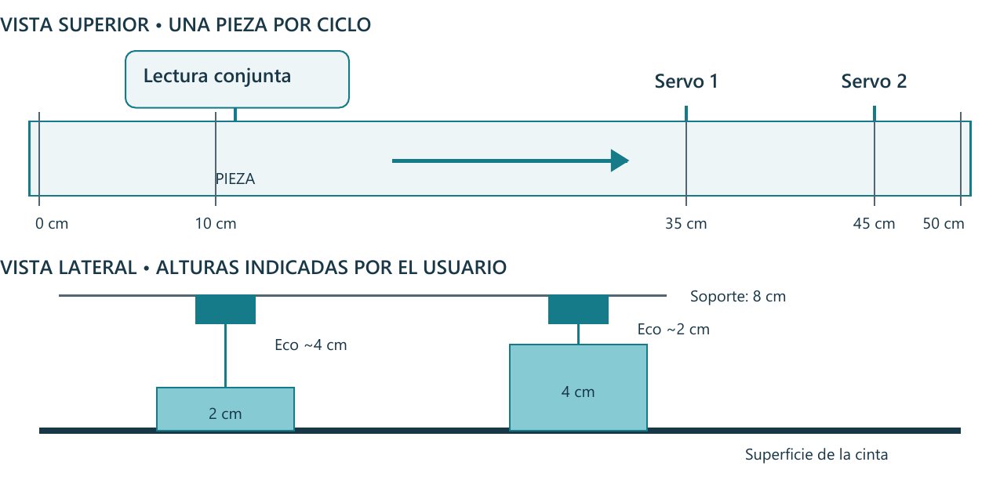
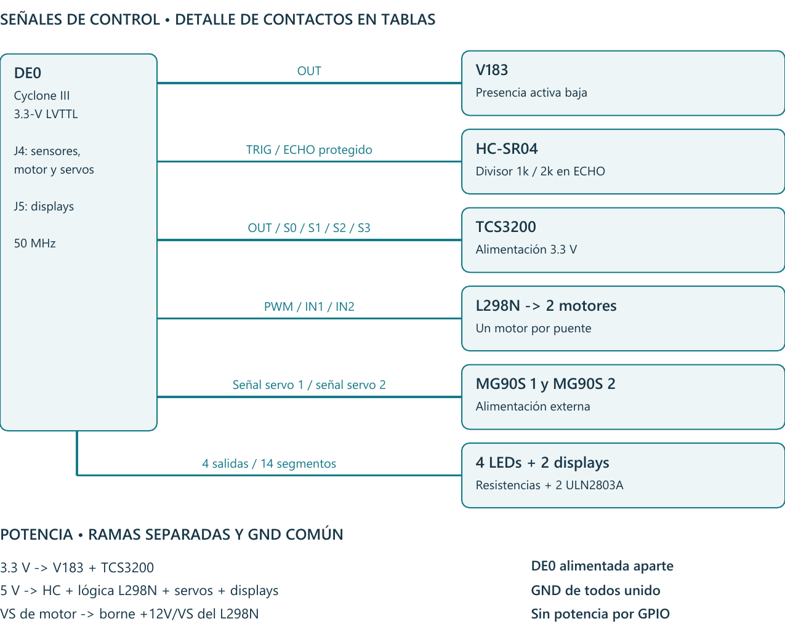

# System Alfa físico v9

Guía de conexión, calibración y comprobación. DE0 / Cyclone III EP3C16F484C6 / 50 MHz / Quartus II 13.1. Fecha: 10 de noviembre de 2026.

## 1. Qué abrir y qué esperar

El proyecto principal es `SystemAlfa/Hardware_Sensores/SystemAlfa_Hardware.qpf`. Su entidad superior es `SystemAlfa_Hardware`. El archivo de programación entregado es `Programacion/SystemAlfa_Hardware.sof`.

La base es la octava versión adjunta, con los lectores de las pruebas individuales ya revisados. Se conserva el núcleo `SystemAlfa_Final`, su ROM de seis categorías, RAM de historial, paquete/función, contadores y FSM. Se añade el control físico alrededor del núcleo. `SystemAlfa_Placa` sigue disponible para las pruebas manuales originales.

Esta entrega implementa sensores, dos motores mediante L298N, dos servos, cuatro LEDs externos de categoría y dos displays externos. Trabaja con **una sola pieza en la cinta por ciclo**. Detiene la cinta para medir, acepta dos lecturas válidas consecutivas iguales y después temporiza el recorrido desde la reanudación.

Al programar, los cuatro porcentajes PWM empiezan en cero y los tiempos están sin calibrar. El automático queda bloqueado hasta configurar el nivel seleccionado. Esto evita presentar tiempos de recorrido inventados como si fueran mediciones del montaje.

**Antes de usar el automático:** comprobar alimentación, probar sensores, ajustar posiciones de los servos, elegir cuatro porcentajes PWM y medir los tres tiempos de recorrido de cada nivel. Las instrucciones están en las secciones 9 y 10.

La compilación y las simulaciones digitales están comprobadas; el conjunto mecánico debe validarse en la mesa. El verde sigue pendiente de calibración real y la lectura de la pieza grande queda cerca del mínimo de alcance del HC-SR04. La implementación no elimina esas dos limitaciones físicas.

`BUTTON1` conserva total, conteos, historial, tiempo de sesión y ajustes físicos. Al apagar o reprogramar se pierden todos esos datos: están en registros/RAM volátiles. Después de reset, el nivel vuelve a 0 y hay que bajar SW3 y volverlo a subir.

## 2. Distribución mecánica y ciclo

Distribución propuesta sobre los 50 cm: estación de lectura a 10 cm de la entrada; servo 1 a 35 cm; servo 2 a 45 cm. Los recorridos desde lectura son aproximadamente 25 cm y 35 cm. Estas posiciones son una propuesta de montaje, no medidas ya tomadas de la cinta.

Se mantienen los datos indicados: soporte a 8 cm de la cinta, proyección aproximada del módulo de 2 cm y bloques de 2 cm y 4 cm. Si la cara de los transductores queda realmente a 6 cm, las distancias de eco serán aproximadamente 4 cm y 2 cm. Medir desde la **cara de los transductores**, no desde el soporte.

El V183 debe detectar la pieza cuando esta cubra simultáneamente la zona observada por el TCS3200 y el HC-SR04. Al cortar PWM el motor queda deshabilitado y la cinta puede avanzar por inercia: ajustar la ubicación del V183 para que la pieza permanezca en la estación durante la lectura.

Secuencia: espera con cinta en marcha -> presencia estable -> motor detenido -> asentamiento de 300 ms -> dos mediciones concordantes, hasta tres intentos -> registro válido -> reanudación -> desvío antes de la llegada -> salida completa -> motor detenido y retorno de servo durante 500 ms -> nueva espera.

No introducir otra pieza hasta que la anterior haya salido y LEDG3 vuelva a encenderse después de la pausa de retorno. El programa detecta un nuevo evento del V183 durante un ciclo ocupado; no puede distinguir dos piezas pegadas ni confirmar un atasco situado después de los sensores.

## 3. Esquema general de conexiones

Las líneas representan grupos de cables; las tablas siguientes detallan cada señal. Los motores y servos reciben potencia de fuentes externas. La DE0 proporciona señales de control de 3.3 V y se alimenta por su conexión habitual.

Conectar todos los GND a una referencia común. Llevar los retornos de corriente de motores y servos directamente a la fuente, sin hacerlos pasar por un cable fino de GND de la DE0. Mantener cortos los cables de sensores y separados de los cables de motor.

Para apagar físicamente los actuadores, cortar su alimentación externa. SW3 y BUTTON1 detienen la orden al motor, pero los servos configurados pueden seguir energizados y mantener su posición de reposo.

## 4. Alimentación y puente H

Usar la fuente de laboratorio con regulación de tensión y limitación de corriente. No se conoce la corriente nominal ni de bloqueo de los motores sin etiqueta; no asignarles una corriente o tensión definitiva solo por su apariencia. Probar cada motor sin carga y después en la cinta, observando corriente, calentamiento y arranque.

Material de adaptación: cables y borneras adecuados; divisor ECHO de 1 kΩ y 2 kΩ; dos resistencias de 10 kΩ para ENA/ENB; cuatro LEDs con cuatro resistencias de 1 kΩ; para los displays, dos ULN2803A DIP-18 y catorce resistencias de 680 Ω. Los drivers de display se necesitan solo si se conectan los displays externos. La fuente/reguladores deben proporcionar las ramas de tensión de la tabla.

| Circuito | Alimentación / conexión | Comprobación antes de energizar |
|---|---|---|
| DE0 | Su alimentación habitual | No unir una fuente externa a su salida de 5 V |
| V183 y TCS3200 | 3.3 V regulados; GND común | OUT no debe entregar 5 V a GPIO |
| HC-SR04 | 5 V regulados | ECHO pasa por divisor 1 kΩ / 2 kΩ |
| L298N: lógica | 5 V externos en borne +5V, con jumper del regulador 5V_EN retirado | Identificar el jumper del regulador; no confundirlo con ENA/ENB |
| L298N: motores | Fuente de motor a borne marcado +12V o VS; negativo a GND | La etiqueta +12V no obliga a usar 12 V. No aplicar 12 V a estos motores sin identificar |
| Servos | Rama externa regulada de 5 V adecuada para ambos | Comprobar tensión durante movimiento; no alimentarlos desde GPIO |
| Displays externos | 5 V externos mediante ULN2803A y resistencias | No conectar sus cátodos de 5 V directamente a GPIO |

Para estos motores de baja tensión se propone alimentar por separado la lógica del L298N y su entrada VS. Si la fuente tiene una sola salida, se necesitan reguladores o una segunda alimentación para obtener las tensiones requeridas. No variar la línea de 5 V de servos/lógica para regular el motor: la velocidad la regula el PWM.

Retirar los puentes ENA y ENB para que la FPGA controle ambas entradas. Colocar una resistencia de 10 kΩ entre cada EN y GND, para mantener el puente deshabilitado mientras la FPGA se programa. Dejar los bornes de motor independientes: OUT1/OUT2 para motor 1 y OUT3/OUT4 para motor 2.

El L298N introduce caída de tensión y calor. Si el motor no arranca bajo carga, medir la tensión real en sus bornes y revisar la transmisión mecánica antes de aumentar la fuente. La hoja de datos de ST respalda el uso de dos puentes y entradas TTL; la disposición exacta de jumpers corresponde al módulo ZX-040 fotografiado y debe confirmarse por su serigrafía.

## 5. Mapa principal: GPIO 0 / J4

**Contacto J4** es el número físico del conector de 40 contactos. **PIN_...** es la bola del FPGA usada en el QSF; no es el número de contacto. Identificar el contacto 1 con la marca de la placa y el manual. No contar posiciones desde una foto sin confirmar orientación.

| Contacto J4 | Dato GPIO0 | PIN FPGA | Cable / destino |
|---|---|---|---|
| 2 | D0 | AB16 | V183 OUT |
| 4 | D1 | AA16 | HC-SR04 TRIG |
| 5 | D2 | AA15 | ECHO después del divisor |
| 6 | D3 | AB15 | TCS3200 OUT |
| 7 | D4 | AA14 | TCS3200 S2 |
| 8 | D5 | AB14 | TCS3200 S3 |
| 9 | D6 | AB13 | TCS3200 S0 |
| 10 | D7 | AA13 | TCS3200 S1 |
| 13 | D8 | AB10 | MOTOR_PWM a ENA y ENB |
| 14 | D9 | AA10 | MOTOR_IN1 a IN1 y a IN3 |
| 15 | D10 | AB8 | MOTOR_IN2 a IN2 y a IN4 |
| 16 | D11 | AA8 | Señal servo 1 |
| 17 | D12 | AB5 | Señal servo 2 |
| 18 | D13 | AA5 | LED categoría 3, con resistencia |
| 20 | D14 | AB4 | LED categoría 4, con resistencia |
| 22 | D15 | AA4 | LED categoría 5, con resistencia |
| 23 | D16 | V14 | LED categoría 6, con resistencia |

J4: contacto 11 = +5 V de la placa; 12 = GND; 29 = +3.3 V de la placa; 30 = GND. Estas alimentaciones de placa no se usan para motores o servos. Los contactos no enumerados quedan sin conectar para este proyecto.

Todas las señales del QSF usan 3.3-V LVTTL. Las asignaciones se contrastaron con el manual DE0 y los QSF de la base. El proyecto físico tiene 83 pines asignados sin duplicados. No importar además otro archivo de pines de una DE0-Nano o DE1.

## 6. Cables de sensores, motores y servos

| Módulo | Conexión detallada |
|---|---|
| V183 | VCC a 3.3 V; GND común; OUT a J4-2. Polaridad confirmada: sin pieza 3.34 V, con pieza 0.1 V. ACTIVO_BAJO = true |
| HC-SR04 | VCC a 5 V; GND común; TRIG a J4-4; ECHO al divisor indicado abajo; punto medio a J4-5 |
| TCS3200 | VCC a 3.3 V; GND y OE a GND; OUT J4-6; S2 J4-7; S3 J4-8; S0 J4-9; S1 J4-10 |
| Motor 1 | Sus dos cables a OUT1 y OUT2 del L298N |
| Motor 2 | Sus dos cables a OUT3 y OUT4 del L298N |
| Control L298N | J4-13 a ENA y ENB; J4-14 a IN1 e IN3; J4-15 a IN2 e IN4; GND común |
| Servo 1 | Señal a J4-16; positivo a 5 V externos; negativo a GND común |
| Servo 2 | Señal a J4-17; positivo a 5 V externos; negativo a GND común |

Divisor de ECHO: `ECHO -- 1 kΩ -- nodo -- J4-5`; desde el mismo nodo conectar `2 kΩ -- GND`. Usar resistencias preferiblemente de 1 %. Con ECHO a 5 V el nodo será aproximadamente 3.33 V. No intercambiar las resistencias ni conectar ECHO directamente al FPGA.

Los colores típicos de servo son rojo = alimentación, marrón/negro = GND y naranja/amarillo = señal, pero confirmar el conector del ejemplar real antes de conectar. La señal PWM es de 3.3 V; verificar que cada servo responda correctamente en la prueba individual.

Ambos motores reciben el mismo porcentaje PWM y solo se usa avance. Esto no iguala sus RPM por realimentación. Si por el montaje uno empuja en sentido contrario, intercambiar los dos cables de ese motor **con la alimentación desconectada**. No intercambiar cables de alimentación ni poner los dos puentes en paralelo.

Por cada LED externo: GPIO -> resistencia de 1 kΩ -> ánodo del LED; cátodo -> GND. Estos cuatro LEDs indican la última categoría física 3, 4, 5 o 6; no representan una medición de movimiento ni una confirmación de salida.

## 7. Displays externos de ánodo común

Se propone **un ULN2803A por display**, para separar los segmentos alimentados a 5 V de los GPIO. Son catorce resistencias, una por segmento, inicialmente 680 Ω. Ajustar brillo solo después de comprobar la corriente permitida por el display. No compartir una sola resistencia en el ánodo común.

| Segmento | J5 velocidad | PIN FPGA | J5 categoría | PIN FPGA | ULN entrada -> salida |
|---|---|---|---|---|---|
| a | 2 / D0 | AA20 | 13 / D8 | Y17 | 1 -> 18 |
| b | 4 / D1 | AB20 | 14 / D9 | W17 | 2 -> 17 |
| c | 5 / D2 | AA19 | 15 / D10 | U15 | 3 -> 16 |
| d | 6 / D3 | AB19 | 16 / D11 | T15 | 4 -> 15 |
| e | 7 / D4 | AB18 | 17 / D12 | W15 | 5 -> 14 |
| f | 8 / D5 | AA18 | 18 / D13 | V15 | 6 -> 13 |
| g | 9 / D6 | AA17 | 20 / D14 | AB9 | 7 -> 12 |

En cada ULN2803A DIP-18: pin 9 a GND común; pin 10 COM sin conectar para estas cargas resistivas; entrada 8 a GND y salida 11 sin conectar. Verificar numeración desde la muesca en vista superior. Conectar cada salida de la tabla a su resistencia y después al cátodo del segmento correspondiente. Los ánodos comunes del display van a +5 V externos; el punto decimal queda desconectado.

El pin numérico de cada segmento depende del modelo del display; no se puede deducir sin su referencia. Identificar a, b, c, d, e, f, g y los comunes mediante su hoja de datos o prueba de diodo antes de cablear. En un ánodo común, la punta roja va al común y la negra al segmento durante esa comprobación.

El QSF ya incluye estos puertos. La opción `EXT_DRIVER_INVERSOR = true` está preparada para ULN2803A: GPIO alto enciende el segmento, aunque el display sea de ánodo común. El display de velocidad muestra 0..3; el de categoría muestra la última categoría física, inicialmente 0. La categoría no cambia al consultar la RAM.

Se puede empezar sin estos dos displays y sin los cuatro LEDs externos: dejar esos cables desconectados. Los cuatro HEX y los diez LEDG de la DE0 permiten calibrar y probar el sistema.

## 8. Switches y botones en automático

Modo automático: **SW0 = 0**. Elegir el modo siempre con SW3 = 0. Los switches SW1 y SW2 ya no simulan color/tamaño en este TOP físico; los sensores proporcionan esos datos.

| Control | Función comprensible |
|---|---|
| SW0 | 0 automático; 1 ajuste y diagnóstico |
| SW1, SW2 | Sin función manual de color/tamaño en automático |
| SW3 | 0 detener; 1 solicitar marcha. Tras BUTTON1 debe pasar por 0 y luego 1 |
| SW4 | 0 vista normal; 1 consultas |
| SW5 | Cada movimiento 0 -> 1 avanza un registro o una categoría/color de consulta; volver a 0 antes de avanzar otra vez |
| SW6 | En historial: 0 muestra ID; 1 muestra tiempo guardado en segundos |
| SW7 | Con SW4=1: 0 historial; 1 cantidades |
| SW8 | En historial: movimiento 0 -> 1 vuelve al último registro válido |
| SW9 | En cantidades: 0 por categoría 1..6; 1 por color 1..3 |
| BUTTON0 | No simula presencia en este TOP; se usa en modo ajuste |
| BUTTON1 | Reset operativo: detiene, limpia alarma/control y exige rearme; conserva sesión y calibración |
| BUTTON2 | Solicita siguiente nivel 0 -> 1 -> 2 -> 3 -> 0; si hay una pieza, se aplica al terminar el ciclo |

Vista normal: HEX3 = nivel de velocidad, HEX2/HEX1/HEX0 = centenas/decenas/unidades del total. Con nivel 0 y total 21 se ve **0021**. El nivel 0 es la primera velocidad calibrada; no significa parada. La parada corresponde a SW3=0.

En historial HEX3 queda apagado y los tres inferiores muestran ID o tiempo. La RAM conserva los últimos ocho registros válidos. En cantidades HEX3 indica qué categoría o color se consulta y los tres inferiores muestran su cantidad. En conteo por color: 1 rojo, 2 verde, 3 azul.

LEDG1..0 = color visible (01 rojo, 10 verde, 11 azul, 00 inválido); LEDG2 = tamaño (0 pequeño, 1 grande); LEDG3 = orden de motor habilitada, encendido fijo; LEDG7..4 = categoría visible o código de fallo; LEDG8 = alarma; LEDG9 = nivel sin calibrar o límite de sesión. En consultas, color/tamaño/categoría pueden corresponder al registro consultado; los actuadores usan la pieza física capturada.

## 9. Modo de ajuste: selección de páginas

Poner SW3=0, después SW0=1. SW9..SW4 forman el número de página en binario. SW2 SW1 eligen el nivel que se está ajustando: 00=0, 01=1, 10=2, 11=3. Esperar al menos 50 ms tras mover switches. Cambiar modo, página o nivel de ajuste con SW3 arriba provoca una parada y requiere BUTTON1.

| Página | SW9..SW4 | Qué muestran HEX3..HEX0 | BUTTON0 / BUTTON2 |
|---|---|---|---|
| 0 | 000000 | Porcentaje PWM, 0000..0100 | +5 % / -5 % |
| 1 | 000001 | Reposo servo 1, microsegundos | +25 / -25 µs |
| 2 | 000010 | Desvío servo 1, microsegundos | +25 / -25 µs |
| 3 | 000011 | Reposo servo 2, microsegundos | +25 / -25 µs |
| 4 | 000100 | Desvío servo 2, microsegundos | +25 / -25 µs |
| 5 | 000101 | Adelanto servo 1, milisegundos | +50 / -50 ms |
| 6 | 000110 | Adelanto servo 2, milisegundos | +50 / -50 ms |
| 7 | 000111 | Cronómetro, centésimas de segundo | Iniciar/marcar / cancelar |
| 8 | 001000 | Distancia HC-SR04 en cm | Nueva medición / sin función |
| 9 | 001001 | Conteo rojo en hexadecimal | Nueva medición RGB+HC / sin función |
| 10 | 001010 | Conteo verde en hexadecimal | Nueva medición RGB+HC / sin función |
| 11 | 001011 | Conteo azul en hexadecimal | Nueva medición RGB+HC / sin función |
| 12 | 001100 | Tiempo guardado a servo 1, centésimas | Solo lectura |
| 13 | 001101 | Tiempo guardado a servo 2, centésimas | Solo lectura |
| 14 | 001110 | Tiempo guardado de salida, centésimas | Solo lectura |

En páginas 0..6 los botones cambian el parámetro incluso con SW3=0. SW3=1 permite probar movimiento: página 0 motor; páginas 1..4 servo seleccionado. En página 7 autoriza iniciar el cronómetro. Las páginas 8..11 funcionan con SW3=0 y no mueven la cinta.

En ajuste: LEDG7..4 muestran página en binario; LEDG3 motor habilitado; LEDG8 fallo de ajuste/mando; LEDG9 **encendido significa nivel calibrado**. LEDG1..0 indican etapa del cronómetro: 00 parado, 01 esperando servo1, 10 esperando servo2, 11 esperando salida. LEDG2 indica que HC y color tienen resultado válido; no es solo validez del HC.

## 10. Ajustar servos y velocidades

**Primero posiciones, después tiempos.** Cualquier cambio de posición o adelanto invalida los tiempos de los cuatro niveles. Cambiar un porcentaje PWM invalida los tiempos de ese nivel. Así no se reutiliza una calibración correspondiente a otra velocidad o geometría de actuación.

1. Con alimentación de actuadores desconectada, revisar cables y dejar los brazos de servo libres de topes. Programar la FPGA y mantener SW3=0.
2. Seleccionar modo ajuste, página 1. El valor inicial es 1500 µs. Energizar el servo 1 y subir SW3 para observarlo. Ajustar con BUTTON0/BUTTON2 hasta la posición de reposo deseada. Bajar SW3 antes de cambiar página.
3. En página 2 ajustar su posición de desvío. Repetir páginas 3 y 4 para el servo 2. El rango disponible es 1000..2000 µs, con período de 20 ms. No equivale a grados exactos para todos los ejemplares.
4. Hay que modificar explícitamente las cuatro posiciones para confirmarlas. Si una posición adecuada es exactamente 1500, pulsar + una vez y - una vez. Reposo y desvío de cada servo deben ser distintos.
5. Las páginas 5 y 6 parten de 300 ms de adelanto, ajustable entre 50 y 1000 ms. Es un valor inicial de maniobra, no un tiempo medido. Comprobar que el brazo alcanza el desvío antes de que llegue la pieza. Si se cambia más tarde, repetir los tiempos de todos los niveles.
6. Probar motores primero sin carga o con la cinta despejada. Página 0, nivel 0, SW3=1. Subir el porcentaje gradualmente en pasos de 5 %. LEDG3 indica habilitación; con porcentaje 0 no hay pulsos aunque LEDG3 esté encendido en esta prueba.
7. Elegir cuatro porcentajes que produzcan avance estable, ordenados de menor a mayor velocidad. No asumir que 25 %, 50 %, 75 %, 100 % sirven para este motor ni que el porcentaje representa una velocidad en cm/s. Anotar corriente y comportamiento bajo carga. Si no arranca, bajar SW3 y revisar antes de continuar.

Los servos ya confirmados mantienen su reposo aunque SW3 esté bajo; SW3 no desconecta su alimentación. El retorno al reposo debe liberar la cinta, sin golpear los bloques ni bloquear el motor. Elegir la posición mecánica de reposo con ese criterio.

## 11. Medir los tiempos reales sin editar VHDL

Medir con una pieza representativa, la misma carga y el mismo punto de partida que tendrá al terminar la captura. Si las longitudes de pieza varían, usar una pieza de la longitud máxima prevista para medir la salida completa. Los servos permanecen en reposo durante esta prueba.

1. Bajar SW3. Seleccionar página 7 y nivel 0 con SW2 SW1=00. Colocar la pieza detenida en la estación, como quedaría después de medirla. Subir SW3: aún no arranca.
2. Pulsar BUTTON0 una vez: comienza la marcha y el cronómetro. LEDG1..0=01.
3. Cuando el frente de la pieza llegue al punto de acción del servo 1, pulsar BUTTON0: guarda T1. LEDG1..0=10.
4. Cuando el frente llegue al servo 2, pulsar BUTTON0: guarda T2, medido desde el mismo arranque. LEDG1..0=11.
5. Cuando la cola de la pieza salga por completo del recorrido, pulsar BUTTON0: guarda Tsalida y detiene. LEDG9 se enciende si posiciones y tiempos son válidos.
6. Bajar SW3. Consultar páginas 12, 13 y 14 para anotar T1, T2 y Tsalida. Repetir para los niveles 1, 2 y 3. BUTTON2 cancela un intento; BUTTON1 lo aborta y exige rearme.

Los valores se muestran en centésimas: 0125 = 1.25 s, 0830 = 8.30 s. El máximo por recorrido es menor de 60 s. Se exige T1 > adelanto1, T2 > T1 y T2 > adelanto2, Tsalida > T2. Cada nueva captura reemplaza la tabla de ese nivel y la deja inválida si se cancela.

| Nivel | PWM % | T1 (cs) | T2 (cs) | Tsalida (cs) | Repeticiones / observaciones |
|---|---|---|---|---|---|
| 0 | ______ | ______ | ______ | ______ | ____________________ |
| 1 | ______ | ______ | ______ | ______ | ____________________ |
| 2 | ______ | ______ | ______ | ______ | ____________________ |
| 3 | ______ | ______ | ______ | ______ | ____________________ |

Repetir varias veces y comprobar que las marcas son consistentes. El temporizador tiene resolución de 10 ms, pero marcar con un botón introduce error humano. El controlador ordena abrir en T1-adelanto1 o T2-adelanto2 y mantiene el desvío hasta Tsalida; deja margen para la cola del bloque. No usar Tsalida como si fuera el tiempo exacto de llegada al servo.

Si cambia la tensión de motor, la carga, la tensión de la banda, el porcentaje PWM o la posición de sensores/servos, repetir la calibración. El sistema no mide velocidad real ni detecta patinamiento. Al acabar una prueba, no dejar una pieza suelta en la cinta para el siguiente arranque.

## 12. Sensores: comprobación y límites

**V183.** Su prueba independiente está en `Hardware_Sensores/Pruebas_Fisicas/V183/Prueba_V183.qpf`. Seleccionar la revisión activa baja. LEDG0 apagado sin pieza, encendido con pieza estable; mantener el objeto no debe producir múltiples eventos. Para verificar voltaje: multímetro en V DC, negra a GND, roja a OUT; la medida ya confirmada fue 3.34 V / 0.1 V. En automático se exige retirar la pieza antes de armar si estaba tapando el sensor al iniciar.

**HC-SR04.** Prueba independiente: `Pruebas_Fisicas/HCSR04/Prueba_HCSR04.qpf`. BUTTON0 mide, BUTTON1 reinicia; HEX2..0 distancia en cm; HEX3 tamaño, apagado si inválido; LEDG0 válida, LEDG1 tamaño, LEDG2 ocupado, LEDG3 alterna al finalizar. Esta versión individual ya usa las ventanas del montaje actual, no los antiguos 25/30 cm.

| Eco desde la cara del sensor | Clasificación inicial |
|---|---|
| 20..28 mm | Grande, tamaño 1 |
| 32..48 mm | Pequeña, tamaño 0 |
| Entre ventanas; menos de 20 mm; más de 48 mm; sin eco | Inválida |
| Cinta vacía aproximadamente a 60 mm | Fuera de las ventanas de pieza |

Las ventanas se comparan con la duración de ECHO, sin redondear previamente a centímetros. HEX muestra cm enteros y por sí solo no permite comprobar límites en mm. El HC-SR04 declara mínimo de 2 cm y requiere separar disparos más de 60 ms; el lector usa 61 ms. Una pieza grande nominalmente a 2 cm está justo en ese mínimo: repetir medidas reales. Si el sensor no la mide de forma estable, no se corrige aceptando cualquier eco corto. Se mantiene la geometría solicitada, con esta limitación documentada.

**TCS3200.** Prueba independiente: `Pruebas_Fisicas/TCS3200/Prueba_TCS3200.qpf`. BUTTON0 inicia; SW1 SW0: 00 rojo, 01 verde, 10 azul. HEX muestra conteos crudos hexadecimales: 002D significa 45 pulsos. LEDG1..0 color, LEDG2 válida, LEDG3 ocupado, LEDG4 alterna al finalizar.

Los parámetros actuales son provisionales: fondo negro R=26/G=26/B=34; ganancias Q5 85/109/115; puntaje mínimo 10; ventaja del canal ganador mayor del 20 %. Ventana 30 ms, asentamiento 0.5 ms, escala 20 %. **El verde real sigue pendiente**. No calibrar solamente con la pantalla del teléfono: usar bloques reales, iluminación y distancia fijas. Ver `CALIBRACION_COLOR_PENDIENTE.md`. Los tres lectores individuales sustituyen temporalmente el programa físico al cargar su SOF; después hay que volver a programar el TOP integrado y recalibrar sus ajustes volátiles.

## 13. Prueba completa y resultados esperados

Con todos los niveles calibrados: bajar SW3, poner SW0=0 y SW4=0, dejar la estación vacía y subir SW3. LEDG9 debe estar apagado y LEDG3 encendido. Introducir una única pieza. LEDG3 se apaga durante lectura, vuelve a encenderse durante recorrido y se apaga brevemente durante retorno de servo.

| Pieza válida | Color / tamaño | Categoría | Acción física | Incremento |
|---|---|---|---|---|
| Roja pequeña | 01 / 0 | 1 | Servo 1 | Total +1; categoría1 +1; rojo +1 |
| Roja grande | 01 / 1 | 2 | Servo 2 | Total +1; categoría2 +1; rojo +1 |
| Verde pequeña | 10 / 0 | 3 | LED externo J4-18 | Total +1; categoría3 +1; verde +1 |
| Verde grande | 10 / 1 | 4 | LED externo J4-20 | Total +1; categoría4 +1; verde +1 |
| Azul pequeña | 11 / 0 | 5 | LED externo J4-22 | Total +1; categoría5 +1; azul +1 |
| Azul grande | 11 / 1 | 6 | LED externo J4-23 | Total +1; categoría6 +1; azul +1 |

| Prueba | Resultado que debe observarse |
|---|---|
| 21 válidas a nivel 0 | Vista normal 0021; último ID 21 |
| Después, color inválido / tamaño dudoso | Parada y alarma; total 21; último ID sigue 21 |
| Reset y siguiente pieza válida | Tras retirar la rechazada y rearmar, total/ID 22 |
| BUTTON1 con SW3 arriba | Motor detenido; no reanuda hasta bajar y subir SW3; sesión conservada |
| BUTTON2 durante una pieza | Termina con su velocidad original; aplica siguiente nivel después |
| Consultar un registro viejo | Cambian los datos mostrados; no se acciona un servo por consultar |
| Falta calibración del nivel | Motor automático bloqueado; LEDG9 encendido |
| Cambiar PWM de un nivel | Se invalidan los tiempos de ese nivel; repetir página 7 |
| Dos eventos de presencia durante un ciclo | Parada, sin contar la segunda pieza |

La categoría se asigna por la ROM. El servo se activa por la categoría capturada del evento válido, no por lo que se muestra en el menú. Categorías 3..6 pasan físicamente sin desvío en esta configuración inicial; sus LEDs solo las representan. No se han construido seis salidas mecánicas con dos servos.

El conteo ocurre al aceptar la clasificación, antes del recorrido. Si después se interrumpe el traslado, esa pieza ya válida permanece contada y registrada; retirarla manualmente y no volverla a introducir como si fuera nueva. La sesión mantiene el límite original de 999 registros/total y tiempo de 0..179 s, que vuelve a cero cada 180 s. Al límite, detener y vaciar la cinta antes de iniciar una nueva sesión reprogramando.

## 14. Fallos y recuperación

En automático, si LEDG8 está encendido y hay fallo del controlador físico, LEDG7..4 muestran este código en binario. LEDG3 indica una orden eléctrica, no que el motor realmente esté girando.

| Código | LEDG7..4 | Significado y acción |
|---|---|---|
| 1 | 0001 | Lectura inválida o vencida. Revisar RGB, distancia y posición; retirar pieza |
| 2 | 0010 | Nueva pieza mientras el ciclo estaba ocupado. Separar piezas |
| 3 | 0011 | Presencia persistente / estación no liberada. Revisar sensor y retirar objeto |
| 4 | 0100 | El núcleo no confirmó el registro válido. Revisar límite, estados y conexión de evento |
| 5 | 0101 | Pieza se retiró durante la medición. Revisar inercia y ubicación de sensores |
| 6 | 0110 | Marcha interrumpida durante un ciclo. Retirar la pieza pendiente antes de rearmar |

Puede haber alarma de mando sin código físico: por ejemplo, cambiar de modo con SW3 alto. En ajuste, LEDG7..4 siguen mostrando la página, no estos códigos. Un fallo de cronómetro se ve por LEDG8 encendido; BUTTON2 cancela y permite repetir.

Recuperación habitual: bajar SW3 -> despejar cinta y estación -> corregir causa -> pulsar BUTTON1 -> esperar con SW3=0 -> subir SW3. No reintroducir una pieza que ya se contó. El reset conserva datos, pero cancela cualquier recorrido pendiente.

Si el motor no se mueve y LEDG3 sí está encendido: revisar porcentaje PWM, fuente en límite de corriente, jumpers ENA/ENB, GND, caída del L298N y transmisión. Si LEDG9 está encendido en automático: completar calibración del nivel o revisar límite de sesión. Si un servo tiembla: comprobar fuente bajo carga y GND antes de modificar temporizadores.

No hay encoder ni sensor de llegada. Un motor atascado lejos del V183, un deslizamiento o una pieza desviada antes de tiempo pueden no detectarse. La guía y los tiempos calibrados describen un prototipo académico; una confirmación de llegada requeriría sensores adicionales.

## 15. Archivos, compilación y verificación

Descomprimir en una carpeta nueva. No mezclar los QSF o el SOF con versiones anteriores. Abrir el QPF de `Hardware_Sensores` y comprobar entidad `SystemAlfa_Hardware` y dispositivo EP3C16F484C6. El QSF ya contiene las fuentes y el mapa de pines; `hardware.sdc` define reloj de 20 ns.

Compilación en Quartus: Processing -> Start Compilation. Programación: Tools -> Programmer -> Hardware Setup -> USB-Blaster -> JTAG; añadir `Programacion/SystemAlfa_Hardware.sof`, marcar Program/Configure y Start. Mantener la alimentación de actuadores desconectada durante la primera programación. La carga SOF es volátil; esta entrega no modifica la memoria de configuración de la placa.

| Archivo / grupo | Cambio y propósito |
|---|---|
| SystemAlfa_Hardware.vhd | Integra calibración, sensores, núcleo, motores, servos y salidas |
| ajuste_fisico.vhd / visor_ajuste.vhd | Tablas de calibración, cronómetro y visualización |
| base_tiempo_fisica.vhd | Pulso común cada 10 ms |
| control_motor_l298n.vhd | PWM de 10 kHz para ambos canales del puente |
| pwm_servo.vhd | PWM reutilizable de 50 Hz; dos instancias |
| medicion_coordinada.vhd | Captura conjunta con reintentos y concordancia |
| control_clasificacion_fisica.vhd | FSM de parada, lectura, recorrido y desvío |
| lector_hcsr04.vhd | Ventanas en mm del montaje, timeout y separación de disparos |
| lector_tcs3200.vhd | Conserva calibración preliminar y conteos crudos |
| SystemAlfa_Final.vhd | Expone marcha/evento/nivel/categoría para conectar actuadores; cambia dos conversiones de display por versiones registradas |
| conversor_decimal_reloj.vhd | Conversión decimal en varios ciclos para cumplir 50 MHz; no cambia conteos |

El núcleo solo se modificó en esos enlaces y conversiones. Rechazos, RAM, ROM, conteos y reset de sesión mantienen la lógica de la octava versión. El rearme SW3 es una capa física adicional. Las FSM nuevas separan registro, transición y salidas. El archivo heredado `control_lectura_sensores.vhd` se conserva como referencia, pero el nuevo TOP usa `medicion_coordinada` y no lo compila en su jerarquía.

`CAMBIOS_Y_ARCHIVOS.md` enumera exactamente nuevos y modificados respecto a la octava. `CODIGOS_NUEVOS_Y_MODIFICADOS.md` contiene sus bloques completos; `TODOS_LOS_VHDL.md` incluye todas las fuentes. `ORDEN_COMPILACION.txt` y el QSF permiten reproducir el orden. `Pruebas_ModelSim/ejecutar_pruebas.do` contiene la ruta de simulación para ModelSim; no se afirma que ese simulador haya sido ejecutado.

Se ejecutaron Quartus II 13.1 y simulaciones GHDL en VHDL-93. Consultar `validacion/RESUMEN_VALIDACION.md` para resultados, márgenes, advertencias y cobertura exacta. No se programó ni se midió esta integración en tu FPGA desde aquí.

## 16. Referencias y hoja de aceptación

Referencias técnicas consultadas para conexiones y límites:

- Manual DE0 de Terasic, capítulo de GPIO y tabla de asignación: https://www.mouser.com/datasheet/2/598/DE0_User_manual_2012-3599596.pdf
- ST, L298: https://www.st.com/resource/en/datasheet/l298.pdf
- ST, ULN2803A: https://www.st.com/resource/en/datasheet/uln2803a.pdf
- HC-SR04, hoja técnica: https://cdn.sparkfun.com/datasheets/Sensors/Proximity/HCSR04.pdf
- ams, TCS3200: https://look.ams-osram.com/m/664723bdb31f55db/original/TCS3200-DS000107.pdf
- TowerPro, MG90S: https://towerpro.com.tw/product/mg90s-3/

| Comprobación física | Resultado / fecha |
|---|---|
| V183 activo bajo y un evento por objeto | __________________________ |
| HC: cinta vacía, bloque 2 cm, bloque 4 cm; repeticiones estables | __________________________ |
| TCS: rojo, verde, azul y fondo con piezas reales | __________________________ |
| Ambos motores avanzan sin oponerse y la fuente no cae | __________________________ |
| Reposo/desvío de ambos servos sin topes ni choques | __________________________ |
| Cuatro porcentajes y doce tiempos anotados | __________________________ |
| 21 válidas -> 0021; rechazo no consume ID | __________________________ |
| Reset detiene, conserva datos y exige rearme | __________________________ |
| Categorías 1/2 desvían y 3..6 encienden LED correcto | __________________________ |
| Repetición de recorrido con carga real en los cuatro niveles | __________________________ |

Guardar las posiciones, adelantos, porcentajes y tiempos en papel antes de apagar. La calibración desde botones sirve para ponerlo en marcha sin inventar constantes. Una vez repetible, esos valores medidos se pueden incorporar como valores iniciales en `ajuste_fisico.vhd` en una revisión posterior.
