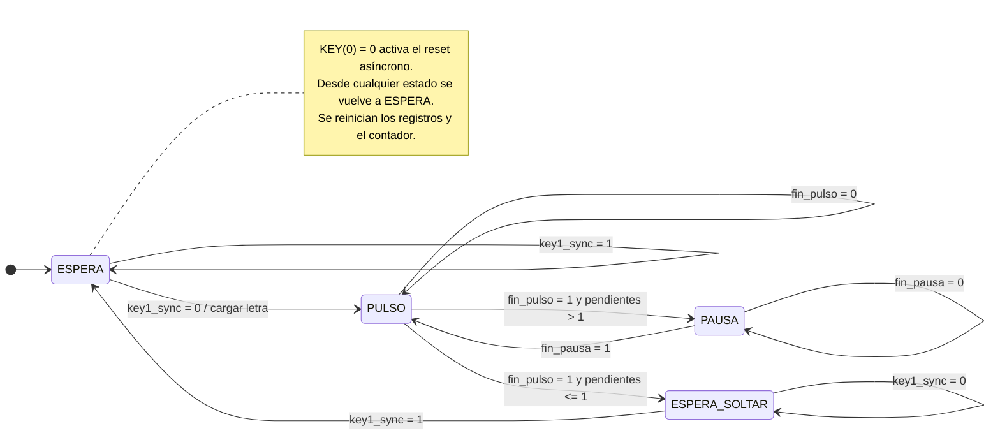

# Diagrama de la FSM del codificador Morse

La salida LEDR(0) permanece encendida únicamente en el estado PULSO.

## Significado de los estados

| Estado | Función | LEDR(0) |
|---|---|---|
| ESPERA | Espera el inicio y carga la letra seleccionada. | 0 |
| PULSO | Transmite un punto o una raya. | 1 |
| PAUSA | Separa dos símbolos consecutivos. | 0 |
| ESPERA_SOLTAR | Espera que se libere el pulsador de inicio. | 0 |

## Selección de letras

KEY(1) inicia la transmisión al presionarlo, con nivel lógico 0.
SW(2 downto 0) selecciona la letra.

| SW(2 downto 0) | Letra | Código Morse |
|---|---|---|
| 000 | A | .- |
| 001 | B | -... |
| 010 | C | -.-. |
| 011 | D | -.. |
| 100 | E | . |
| 101 | F | ..-. |
| 110 | G | --. |
| 111 | H | .... |

La selección se captura al iniciar. Cambiar los interruptores durante
la transmisión no modifica la letra en curso.

## Duraciones

Con un reloj de 50 MHz y G_TICKS_05S = 25_000_000:

- Punto: 0,5 segundos.
- Raya: 1,5 segundos.
- Pausa entre símbolos: 0,5 segundos.

En el testbench se usa G_TICKS_PRUEBA = 4:

- Punto: 80 ns.
- Raya: 240 ns.
- Pausa entre símbolos: 80 ns.

## Condiciones de finalización

`fin_pulso` indica que el contador alcanzó la duración del símbolo actual.

`fin_pausa` indica que terminó la separación entre símbolos.

`pendientes` incluye el símbolo que se está transmitiendo. Si vale 1
al finalizar un pulso, la letra ha terminado.

Mantener KEY(1) presionado no repite la letra. Para iniciar otra
transmisión, se debe liberar y volver a presionar el pulsador.